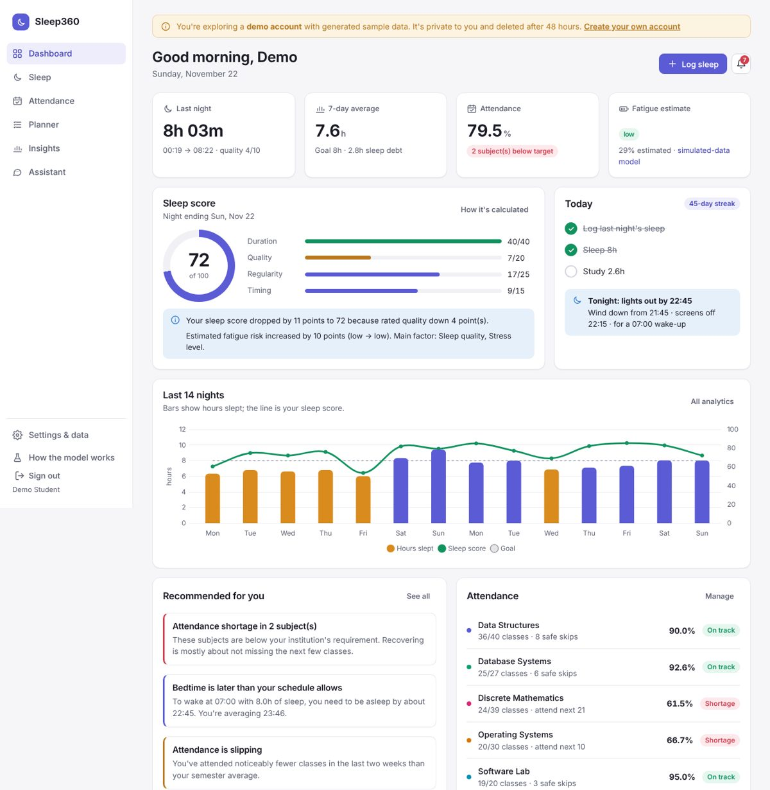
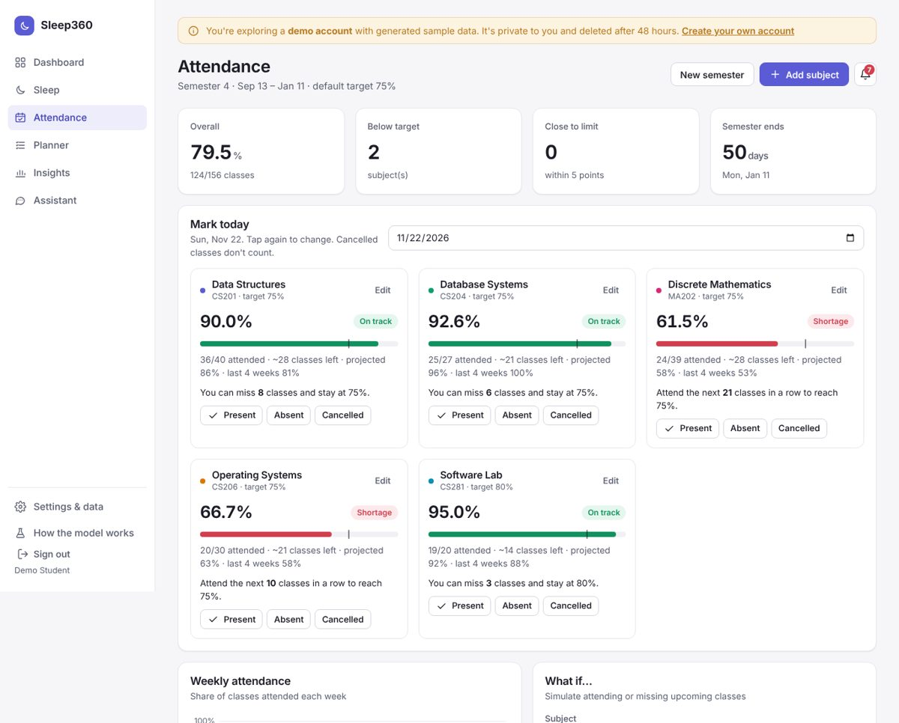
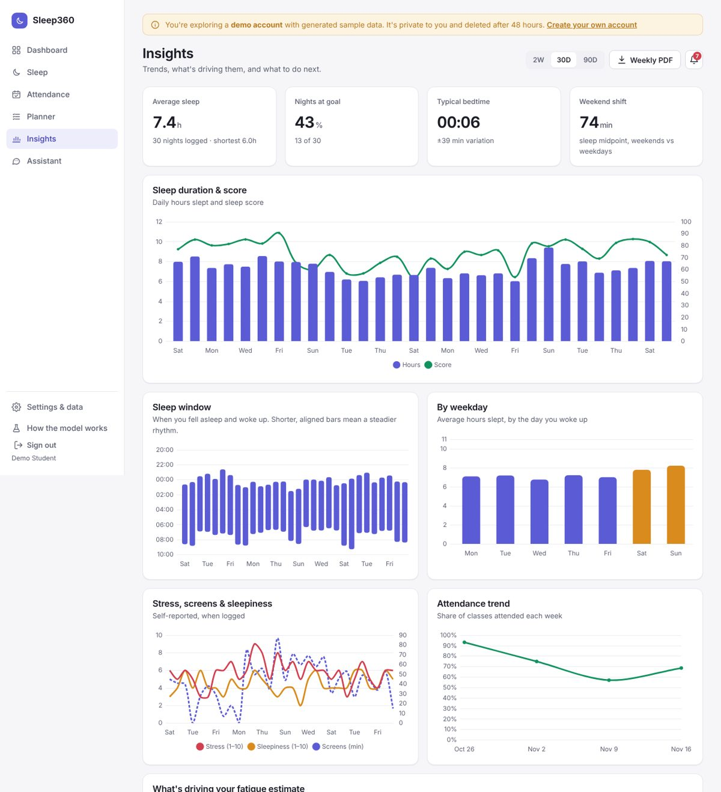
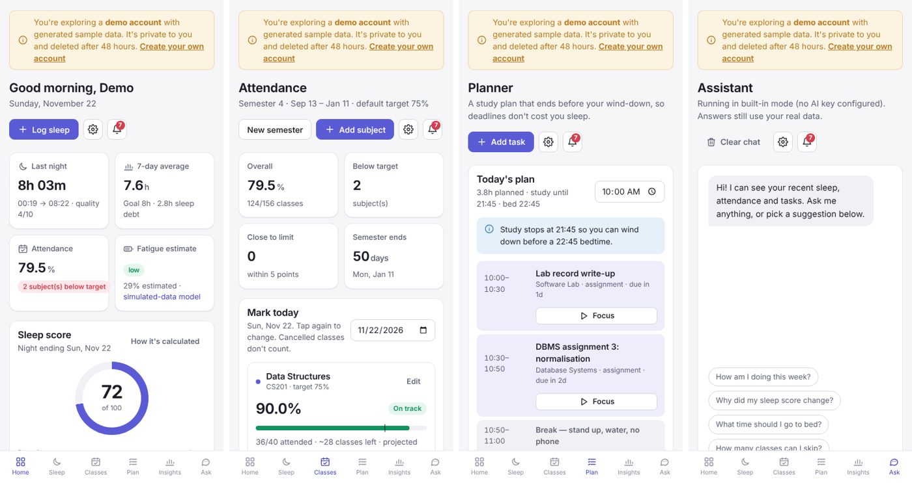

# Sleep360

**A student wellness platform that connects sleep, attendance and study planning, and explains its numbers honestly.**

[](https://github.com/khushir11/Sleep360/actions/workflows/ci.yml)
    

Students log a night in about 20 seconds and mark classes as they go. Sleep360 then:

- scores each night with a **transparent 4-part sleep score** and explains in plain English why it changed;
- does **exact attendance maths**: classes needed to reach the target, safe skips, end-of-semester forecast and "what-if" simulation, all configurable to the institution's rule;
- builds a **sleep-friendly study plan** that spreads deadlines across days and never schedules work after the wind-down;
- produces a **fatigue estimate** from an ML pipeline (LR / RF / GB compared with grouped CV), with per-user explanations and a public model card that says plainly it's trained on simulated data;
- answers questions through an **AI assistant (Claude)** grounded in the user's own numbers, with a crisis-safety layer and a deterministic fallback;
- generates **recommendations, notifications, streaks/badges, analytics and a weekly PDF report**.

<p align="center"></p>

| Attendance | Insights | Mobile |
|---|---|---|
|  |  |  |

---

## Contents
[Features](#features) · [Architecture](#architecture) · [Quick start](#quick-start) · [Configuration](#environment-variables) · [Testing](#testing) · [Deployment](#deployment) · [ML](#machine-learning) · [Limitations](#limitations) · Docs: [Architecture](docs/ARCHITECTURE.md) · [API](docs/API.md) · [ML](docs/ML.md) · [Interview guide](docs/INTERVIEW_GUIDE.md) · [Changelog](CHANGELOG.md)

## Features

| Area | What it does |
|---|---|
| **Dashboard** | Last night, 7-day average and sleep debt, attendance, fatigue estimate, sleep score with component bars and a "why it changed" explanation, today's goals, tonight's bedtime, 14-night chart, top recommendations, deadlines, streaks and badges. |
| **Sleep logging** | One row per night (upsert by wake date). Bed/wake time, quality, optional stress, daytime sleepiness, screens, caffeine, exercise and private notes. History, delete, **CSV import pipeline** for spreadsheets and wearable exports. |
| **Bedtime planner** | Goal-based bedtime, wind-down, screens-off and last-caffeine times, plus approximate 90-minute-cycle options. |
| **Attendance** | Semesters → subjects → per-class records (present / absent / cancelled; cancelled classes don't count). Opening balances for mid-semester starts, per-subject target overrides (e.g. 80% labs), classes needed, safe skips, remaining-class forecast, max achievable %, projected end %, weekly trend, monthly history, what-if simulator. |
| **Study planner** | Tasks (assignments, exams, study) with estimates and due dates. Daily plan with 50/10 focus blocks that stops 60 minutes before bedtime, and a 25% lighter plan after a short night. Focus timer with break reminders that logs study sessions. Weekly goal progress, by-subject breakdown and a cautious sleep↔study correlation from the user's own data. |
| **Recommendations** | Rule engine (15 rules): short sleep, sleep debt, irregular schedule, social jet lag, late bedtime, screens rising, late caffeine, stress (with helpline at high levels), low activity, attendance shortage / near-limit / declining, exam-week sleep, positive reinforcement. Each card shows *why* (your numbers) and a source. |
| **Insights** | 2W / 30D / 90D analytics: duration and score, sleep-window chart, weekday pattern, stress, screens and sleepiness, attendance trend, per-feature fatigue drivers, week-by-week consistency table. |
| **Assistant** | Claude via the Anthropic API with a compact numeric context (no email or notes). A crisis-language check runs first and returns a fixed response with helplines. Falls back to a deterministic, data-grounded intent engine when there's no key or on any error. |
| **Engagement** | Logging and sleep-goal streaks, a 7-night consistency challenge, 8 badges, in-app notifications (bedtime, missing log, attendance alerts, deadlines, weekly report) with optional browser notifications. |
| **Privacy** | Per-user scoping on every query (foreign IDs → 404), JSON export, one-click account deletion (cascades), isolated 48-hour demo sandboxes, public model card and privacy page. |

## Architecture

```
Browser (Jinja page shells + ES-module JS + Chart.js, no build step)
   │  fetch /api/v1/*  (session cookie + X-CSRFToken)
   ▼
Flask app factory ─ blueprints: web (pages) · api (REST v1)
   │  Pydantic validation → service layer (pure Python, unit-tested)
   │     sleep_metrics · attendance · planner · recommendations · assessments
   │     importer (CSV ETL) · assistant · notifications · achievements · reports
   ├─ ml/  features (shared train/serve) · synthetic · train · predictor
   ├─ SQLAlchemy 2.0 models ─ Alembic migrations ─ Postgres (prod) / SQLite (dev)
   └─ Anthropic API (optional)
```

Key decisions (details in [docs/ARCHITECTURE.md](docs/ARCHITECTURE.md)):
- **Thin routes, fat services.** All logic lives in `sleep360/services/`, so it can be tested without HTTP.
- **One feature function for training and serving** (`ml/features.py`), which prevents training/serving skew.
- **Assessments are persisted per user-day**, so "why did my score change?" is a diff, not a guess.
- **Server-rendered shells plus a JSON API** instead of a SPA: one deployable, no Node build, and the API is ready for a mobile client.
- **Strict CSP** (`script-src 'self'`): Chart.js and the Inter font are vendored, with no inline scripts or styles.

```
sleep360/
├── __init__.py          # app factory, security headers, error handlers
├── config.py            # env-driven config classes
├── models.py            # 11 tables (see docs/ARCHITECTURE.md for the ERD)
├── schemas.py           # Pydantic request schemas
├── api/                 # REST v1: auth, sleep, attendance, planner, insights, assistant, account
├── web/                 # page routes
├── services/            # business logic
├── ml/                  # features, synthetic data, training, predictor, artifacts/
├── templates/ static/   # UI
└── cli.py               # flask ml train | demo create/cleanup | notifications scan | assess backfill
migrations/              # Alembic
tests/                   # pytest (55 tests, 88% coverage)
scripts/e2e_smoke.py     # Playwright end-to-end journey
```

## Quick start

```bash
git clone https://github.com/khushir11/Sleep360.git && cd Sleep360
python -m venv .venv && source .venv/bin/activate      # Windows: .venv\Scripts\activate
pip install -r requirements-dev.txt
cp .env.example .env                                    # set SECRET_KEY; set SESSION_COOKIE_SECURE=0 for http://localhost
flask --app wsgi db upgrade                             # create the database
flask --app wsgi demo create                            # optional: demo@sleep360.dev / Demo12345
flask --app wsgi run                                    # http://127.0.0.1:5000
```

Or click **Try the demo** on the landing page. It creates a private sandbox with generated data.

With Docker:
```bash
docker build -t sleep360 . && docker run -p 8000:8000 -e SECRET_KEY=$(openssl rand -hex 32) -e SESSION_COOKIE_SECURE=0 sleep360
```

## Environment variables

| Variable | Required | Default | Purpose |
|---|---|---|---|
| `SECRET_KEY` | **yes** | – | Signs sessions and CSRF tokens. The app refuses to start without it. |
| `APP_ENV` | no | `development` | `development` or `production` |
| `DATABASE_URL` | prod | SQLite in `instance/` | Postgres URL (`postgres://` is normalised automatically) |
| `ANTHROPIC_API_KEY` | no | – | Enables the Claude assistant. Without it, the built-in guide answers. |
| `ANTHROPIC_MODEL` | no | `claude-haiku-5-5` | Any Claude model id |
| `ASSISTANT_MAX_TOKENS` | no | `700` | Reply length cap |
| `SESSION_COOKIE_SECURE` | no | `1` | Set `0` only for plain-HTTP local dev |
| `RATELIMIT_STORAGE_URI` | no | `memory://` | Use `redis://…` when running multiple instances |
| `MODEL_PATH` | no | bundled artifact | Alternative model file |

**Getting an Anthropic key:** create one at console.anthropic.com → API keys, then set `ANTHROPIC_API_KEY` in `.env` or in the Render dashboard. Keys are only read from the environment and never sent to the browser.

## Testing

```bash
pytest --cov=sleep360          # 55 tests: auth/security, isolation, attendance maths, sleep scoring,
                               # CSV pipeline, ML pipeline, planner, recommendations, assistant (mocked LLM),
                               # notifications, PDF/export, pages
ruff check . && ruff format --check .
BASE_URL=http://127.0.0.1:5000 python scripts/e2e_smoke.py   # browser journey (needs `pip install playwright`)
```

Latest results: **55 passed, 88% coverage**, ruff clean. Migrations and the full API were also exercised against **PostgreSQL 16**, which caught a column-length bug that SQLite silently accepts (see the changelog). The Playwright journey passes with no JS errors. Pages were checked at 1366×900 and 390×844.

CI (GitHub Actions) runs lint, tests with coverage, and `db upgrade` + `db check` against a Postgres service on every push and PR.

## Deployment

**Render (recommended, matches the original deployment).** `render.yaml` is a Blueprint for a web service plus managed Postgres:
1. Push to GitHub → Render Dashboard → **New → Blueprint** → select the repo.
2. Render generates `SECRET_KEY` and wires `DATABASE_URL`. Optionally add `ANTHROPIC_API_KEY`.
3. Each deploy runs `flask db upgrade` before starting gunicorn. Health check: `/api/v1/health`.

Notes: Render's free Postgres expires after a period of time (check Render's current terms), so use a paid instance for anything long-lived. On free web services the in-memory rate limiter resets on restart; use Redis for `RATELIMIT_STORAGE_URI` if that matters.

**Scheduled jobs (optional):** run `flask --app wsgi notifications scan` hourly and `flask --app wsgi demo cleanup` daily (Render Cron Job or any scheduler). Notifications are also generated when a user opens the dashboard.

**Any Docker host:** use the included `Dockerfile` (non-root user, migrations on start, gunicorn with 2 workers × 4 threads).

## Machine learning

Target: next-day fatigue (self-reported daytime sleepiness ≥ 7/10). 10 engineered features (last night, 7-day mean, 7-day sleep debt, bedtime SD, bedtime lateness, quality, stress, screens, caffeine, exercise).

| Model (5-fold GroupKFold by student) | ROC-AUC | Avg precision | Brier |
|---|---|---|---|
| **Logistic regression (selected)** | **0.742 ± 0.012** | 0.619 | 0.179 |
| Random forest | 0.739 ± 0.014 | 0.619 | 0.180 |
| Histogram gradient boosting | 0.740 ± 0.013 | 0.620 | 0.179 |
| Baseline: "slept < 6h" rule | 0.570 | 0.398 | 0.222 |
| Baseline: base rate | 0.500 | 0.323 | 0.219 |

> ⚠️ **Trained on simulated data.** No real student dataset was available. The generator encodes assumed effects whose directions come from sleep research and whose magnitudes are invented, so these metrics measure how well the pipeline recovers a known signal, not anything about real students. Every place the estimate appears in the app says so. The app collects a real label (daytime sleepiness), and `flask ml train --source db` retrains on consented, non-demo data once there's enough (≥200 rows, ≥10 users).

The trees didn't beat logistic regression, so the simpler, more interpretable model was selected (the rule is "simpler wins within 0.005 AUC"). Full write-up: [docs/ML.md](docs/ML.md). Live model card: `/model`.

## Limitations

- **Not a medical device.** Sleep360 gives wellness guidance, not diagnoses.
- **The fatigue model is trained on simulated data** (see above). The sleep score is a designed heuristic.
- **No wearable APIs.** Fitbit, Google Fit and Apple Health need OAuth apps and developer accounts. The CSV import accepts their exports today; direct sync would plug into the same `importer` pipeline.
- **Notifications are in-app plus browser notifications while a tab is open.** True push (Web Push / email) needs VAPID keys or an email provider.
- **Peer challenges** were deliberately not built: comparing students' wellness data raises privacy issues that need consent design first.
- **The demo is rate-limited** (5 per hour per IP). Stale demos are removed by `flask demo cleanup`.

## License

MIT, see [LICENSE](LICENSE).
